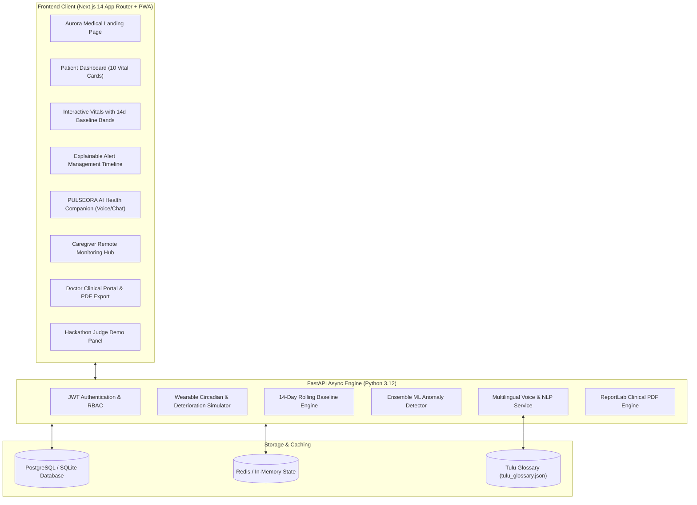

# PULSEORA — Advanced AI-Powered Wearable Health Monitoring & Early Warning Platform
> **Tagline:** Every Beat. Every Signal. Every Life.  
> **Innovation Partner:** Nitte Pharma Innovation Centre  
> **Hackathon:** Build4Karnataka 2026  
> **Category:** AI Healthcare Technology / Wearable Early Warning System  

---

## 1. Executive Summary

**PULSEORA** is an intelligent wearable-based early warning system designed to continuously monitor individual health patterns, particularly for elderly patients and individuals living with chronic conditions.

Traditional health monitoring relies on static, generic thresholds (e.g., alert if heart rate exceeds 100 BPM), causing two critical failures:
1. **Missed subtle deterioration:** A patient with a resting baseline of 62 BPM who drifts to 84 BPM over 48 hours is experiencing acute physiological strain, yet standard monitors consider 84 BPM "normal".
2. **Alarm fatigue:** Mundane exercise or stair-climbing triggers false alarms when context is ignored.

PULSEORA solves this by learning **personalized 14-day rolling circadian diurnal baselines**, using an **ensemble anomaly detector** (Z-score + EWMA + Isolation Forest + Context Filtering), and translating shifts into explainable risk alerts and natural conversational guidance in **English, Kannada, and Tulu**.

> **Important Regulatory Disclaimer:** PULSEORA is a health-monitoring and early-warning decision support platform. It is not a clinically validated diagnostic device.

---

## 2. Platform Architecture



---

## 3. Key Innovation Features

1. **Personalized 14-Day Rolling Baselines:**
   - Calculates diurnal hourly distributions (mean, median, standard deviation, and 10th-90th percentiles).
   - Dynamically adapts to seasonal and physiological baseline trends.

2. **Multi-Model Ensemble Anomaly Detection:**
   - **Z-Score:** Identifies statistical outliers from diurnal expectations.
   - **EWMA (Exponentially Weighted Moving Average):** Detects short-term rate-of-change spikes.
   - **Isolation Forest (scikit-learn):** Flags multi-dimensional vital anomalies (HR, HRV, SpO2, RespRate).
   - **Context Filtering:** Filters out physical exertion when high step counts explain heart-rate increases.

3. **Multilingual AI Health Companion:**
   - First-class support for **English**, **Kannada**, and **Tulu** (Coastal Karnataka dialect).
   - 155+ verified clinical terms in `tulu_glossary.json`.
   - Voice assistant with Web Speech API (speech-to-text and text-to-speech in `en-IN` & `kn-IN`).
   - Red-flag triage safety guardrails (immediate 112 / 108 emergency escalation for chest pain, acute dyspnea, or syncope).

4. **Caregiver & Doctor Modules:**
   - Caregiver portal with loved ones sorted by continuous risk score.
   - WhatsApp check-in stub and 1-tap call actions.
   - Doctor dashboard with 1-click **Clinical PDF Telemetry Report** generation.

5. **Interactive Judge Demonstration Panel (`/demo`):**
   - 5 pre-seeded demo patients with 30 days of realistic historical circadian vitals.
   - **"Simulate Health Deterioration"** button to inject gradual physiological decline and observe real anomaly calculations in real-time.

---

## 4. Localhost Quickstart

Both servers are currently configured and running on Windows:

| Service | URL | Notes |
| :--- | :--- | :--- |
| **Frontend Web App & PWA** | [http://localhost:3000](http://localhost:3000) | Responsive UI with Aurora Pulse engine |
| **Backend API & Swagger Docs** | [http://localhost:8000/docs](http://localhost:8000/docs) | OpenAPI interactive documentation |
| **ReDoc API Documentation** | [http://localhost:8000/redoc](http://localhost:8000/redoc) | Clean alternate API reference |

### Demo Accounts

Password for all demo accounts: **`Pulseora@123`**

- **Patient (Normal Baseline):** `ramesh@pulseora.health` (Ramesh Kumar, 68 yrs, score: 14.0)
- **Patient (Watch Baseline):** `meenakshi@pulseora.health` (Meenakshi Bhat, 72 yrs, Kannada/Tulu)
- **Patient (Warning Alert):** `prema@pulseora.health` (Prema Shetty, 70 yrs, score: 58.0)
- **Caregiver:** `kavitha@pulseora.health` (Kavitha Kumar, daughter of Ramesh)
- **Doctor:** `dr.shenoy@pulseora.health` (Dr. Sudhir Shenoy, Nitte Medical Complex)
- **Administrator:** `admin@pulseora.health`

---

## 5. Two-Minute Hackathon Demo Script (For Judges)

1. **Step 1: Open Home & Brand Identity**
   - Navigate to [http://localhost:3000](http://localhost:3000).
   - Observe the **Aurora Pulse** animated background and biometric heartbeat logo.
   - Toggle the language switcher (**EN / ಕನ್ನಡ / ತುಳು**) in the header.

2. **Step 2: Judge Demo Panel**
   - Click **"⚡ Judge Demo"** in the top navigation or visit [http://localhost:3000/demo](http://localhost:3000/demo).
   - Select patient **"Ramesh Kumar"**. Notice his stable 14-day learned baseline (Resting HR ~68 BPM, SpO2 ~98.2%, Risk Score: 14 / Normal).

3. **Step 3: Trigger Deterioration**
   - Click the red **"Simulate Health Deterioration"** button.
   - Watch the live telemetry stream introduce gradual multi-day physiological drift (Resting HR rises to 82 BPM, SpO2 dips to 93.8%, HRV declines).
   - The Ensemble Anomaly Detector calculates the new risk score (~58 / Warning) and generates an explainable alert:
     > *"Physiological Deterioration Detected: Resting HR is 18.5% above normal baseline, accompanied by a 4.1% reduction in blood oxygen saturation."*

4. **Step 4: AI Health Companion Explanation**
   - Click **"Talk to AI Companion"** (or the microphone button).
   - Type or say: *"Explain my latest alert"* or switch to Kannada: *"ನನ್ನ ಆರೋಗ್ಯ ಹೇಗಿದೆ?"*.
   - The assistant explains the physiological shift in plain language with clinical advice.
   - Test safety guardrails by typing: *"I have sudden severe chest pain"*; observe the immediate **108 / 112 emergency escalation banner**.

5. **Step 5: Doctor Portal & Clinical PDF Report**
   - Navigate to [http://localhost:3000/doctor](http://localhost:3000/doctor).
   - Click **"Download PDF"** next to Ramesh Kumar.
   - View the generated PDF featuring demographic data, 14-day baseline tables, recent telemetry, and clinical disclaimers.

---

## 6. Project Directory Structure

```text
/pulseora
  /frontend
    /app
      page.tsx          # Complete landing page with 14 sections
      layout.tsx        # Responsive PWA layout & viewport
      /dashboard        # Patient dashboard with 10 vital cards
      /vitals           # Interactive Recharts with 14d baseline bands
      /alerts           # Explainable alert timeline & actions
      /analytics        # Sleep & activity recovery analytics
      /caregiver        # Caregiver remote monitoring hub
      /doctor           # Doctor clinical dashboard & PDF download
      /demo             # Hackathon judge demo panel
      /settings         # Settings, consents & language preferences
    /components
      /brand            # PULSEORA SVG biometric logo variants
      /visuals          # Aurora Pulse animated background
      /navigation       # Desktop header & mobile-first bottom nav
      /companion        # AI Health Companion modal with voice STT/TTS
      /demo             # Real-time simulation control panel
    /public
      manifest.json     # PWA Web App Manifest
      sw.js             # Service worker for offline caching
      offline.html      # Offline fallback experience
  /backend
    /app
      /api/v1           # Auth, vitals, baselines, alerts, companion, simulator, reports
      /core             # Config, security (JWT/bcrypt), database session
      /models           # 17 SQLAlchemy 2.0 database entities
      /schemas          # Pydantic V2 schemas
      /services         # Seed data, baseline engine, companion, simulator, PDF reports
      /ml               # Z-score, EWMA, Isolation Forest ensemble detector
      /i18n             # 155-entry verified tulu_glossary.json, language detector
    /tests              # Pytest automated test suites
    main.py             # FastAPI entrypoint
  docker-compose.yml    # Multi-container Docker deployment
  .env.example          # Environment variables template
  README.md             # Platform documentation & judge guide
```

---

*Developed for Build4Karnataka in collaboration with Nitte Pharma Innovation Centre.*
